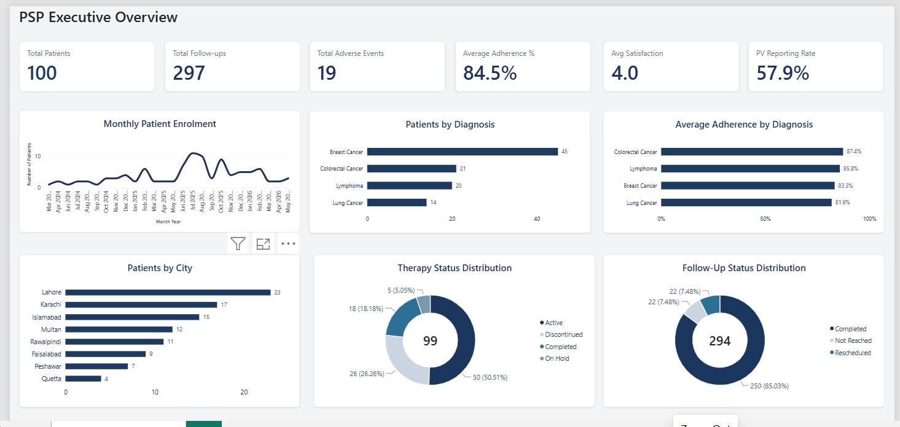

# Oncology Patient Support Program (PSP) Executive Dashboard (Power BI)

## Project Overview
An end-to-end **Power BI** business intelligence solution built for an **Oncology Patient Support Program (PSP)** and Pharmacovigilance workflow. Built entirely inside Power BI from raw data ingestion to executive reporting, this project models multi-table healthcare operations across **100 oncology patients**, **297 follow-up calls**, and **19 adverse events** to track therapy retention, diagnosis-level adherence, and drug safety reporting compliance.

*(Note: This project uses a synthetic dataset created for portfolio and training purposes and contains no real patient records.)*

## Technical Architecture & Power BI Workflow
* **Power Query (ETL):** Cleaned, standardized, and transformed six relational tables (`Patients`, `Hospitals`, `Therapy`, `FollowUps`, `AdverseEvents`, and a custom `DimDate` calendar table).
* **Star Schema Data Modeling:** Established one-to-many relationships connecting dimension tables (`DimDate`, `Patients`, `Hospitals`) to fact tables (`Therapy`, `FollowUps`, `AdverseEvents`) for accurate cross-filtering.
* **DAX Measures:** Engineered custom DAX calculations for core operational and clinical KPIs, including **Average Adherence %**, **Average Patient Satisfaction**, and **Pharmacovigilance (PV) Reporting Rate %**.
* **Executive Visualization:** Designed a single-page executive overview featuring 6 KPI cards, time-series enrolment tracking, diagnosis-level bar charts, city distributions, and donut charts for therapy and outreach status.

## Dashboard Preview

## Key Findings
* **Program & Clinical Overview:** Tracked **100 enrolled oncology patients**, **297 follow-up interactions**, and **19 adverse events**, achieving an overall **84.5% average medication adherence** and a **4.0 / 5.0 average patient satisfaction score**.
* **Pharmacovigilance (PV) Compliance:** Recorded a **57.9% PV Reporting Rate** across logged adverse events, highlighting an operational opportunity to improve drug safety escalation workflows.
* **Diagnosis Breakdown & Adherence:** **Breast Cancer** represented the largest patient cohort, followed by **Colorectal Cancer**, **Lymphoma**, and **Lung Cancer**, with **Colorectal Cancer** patients showing the highest average adherence (**87.4%**).
* **Therapy & Outreach Status:** **50.51% (50)** of patients remained on **Active** therapy, while **20.20% (20)** discontinued and **19.19% (19)** completed treatment. Across follow-up calls, **85.03% (250)** were **Completed**, while **7.48% (22)** were **Not Reached** and **7.48% (22)** were **Rescheduled**.
* **Geographic Concentration:** Patient enrolment was led by **Lahore** and **Karachi**, followed by **Islamabad**, **Multan**, and **Rawalpindi**.

## Files Included
* `PSP_new_project.pbix` – Complete Power BI Desktop file containing Power Query transformations, Star Schema relationships, DAX measures, and the interactive report.
* `oncology_psp_dashboard.png` – High-resolution preview of the PSP Executive Overview dashboard.
